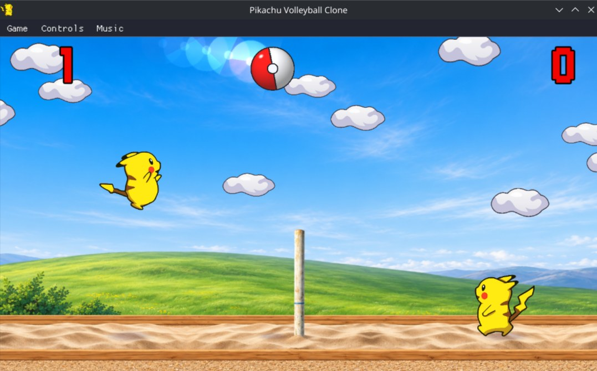

# Pikachu Volleyball Clone



A Rust remake of the classic two-player volleyball game starring Pikachu, with
HD graphics and smooth animation. Play against the computer or share a keyboard
with a friend, and try to land the ball
on the other side of the net before your opponent does.

The game is based on **Pikachu Volleyball**, originally released in 1997 by
SACHI SOFT / SAWAYAKAN Programmers and Satoshi Takenouchi. This remake adds
a widescreen court, redesigned menus, keyboard and gamepad support, and an
Android version with invisible touch controls.

**Website and online demo: https://ordigital.github.io/pikachu-volleyball-clone/**

## Downloads

Prebuilt Windows x86-64, Linux x86-64 / ARM64 AppImages, an Android APK, a
Sega Mega Drive / Genesis ROM and an NES ROM are available from the
[Releases page](https://github.com/ordigital/pikachu-volleyball-clone/releases).
You can also play the [browser version](#browser-version) without installing anything.

On Windows, extract the ZIP and run `pikachu-volleyball.exe`. On Linux, download
the AppImage for your architecture, make it executable and run it:

```sh
chmod +x Pikachu-Volleyball-Clone-*.AppImage
./Pikachu-Volleyball-Clone-*.AppImage
```

Use the filename for your architecture if both AppImages are in the same folder.
AppImages require glibc 2.34 or newer, system ALSA and X11/EGL/OpenGL libraries, and
a desktop with OpenGL support. On systems without FUSE, run with
`APPIMAGE_EXTRACT_AND_RUN=1` before the AppImage command.

On Android, download the APK and allow installation from your browser or file
manager when prompted. It supports Android 5.0 and newer on ARM64 / ARMv7 phones;
Google Play is not required. See the touch controls and Android sections below.

## Building from source

Install [Rust](https://www.rust-lang.org/tools/install), then clone and run:

```sh
git clone git@github.com:ordigital/pikachu-volleyball-clone.git
cd pikachu-volleyball-clone
cargo run --release
```

On Debian or Ubuntu, install the native audio, gamepad and windowing dependencies:

```sh
sudo apt install libasound2-dev libudev-dev libx11-dev libxi-dev libgl1-mesa-dev libegl1-mesa-dev
```

The game's graphics, fonts and sounds are embedded in the executable. You can
also build without running it using `cargo build --release`. Keep `vendor/miniquad/`
in source checkouts: it contains the renderer fix for missing menu text and score
digits after font-atlas growth. See [the patch notes](vendor/miniquad/PATCHES.md).

## How to play

Choose **1 Player** to play against the computer or **2 Players** for a local
match. Move and jump to keep the ball in play, and use the power hit to send it
past your opponent. Score points by landing the ball on their side; the first to
reach the selected score wins.

After 30 seconds without player input, the menu starts an automatic demo. Menu
music fades out before the demo or after confirming the player selection; use
the Music menu to turn music on or off. Sound effects are always enabled with
stereo positioning.

| Action | Player 1 | Player 2 |
| --- | --- | --- |
| Move left / right | D / G | Left / Right arrows |
| Jump / down | R / F | Up / Down arrows |
| Power hit / confirm | Z | Enter |

Gamepads are supported: use the D-pad or left stick to move and the A button to
hit. On Windows, gamepads must support XInput. Use **Controls** to change keyboard or gamepad bindings.
Settings are saved in `controls.txt` next to the executable or AppImage.

| Shortcut | Action |
| --- | --- |
| P | Pause or resume the match and music |
| Esc | Confirm returning to the menu during a match, or exiting from the menu (desktop only) |
| Alt+Enter / F11 | Toggle fullscreen |
| F1 | Restart to the menu |

In fullscreen, move the pointer to the top edge to show the menu bar.

### Touch controls

Touch controls are enabled by default on Windows, Linux (x86-64 / ARM64) and
Android. There are no on-screen arrows or buttons:

- Touch anywhere on the left half, then drag left or right to move. The initial
  contact becomes the stick's center; drag up to jump and down to aim a hit.
- Tap the right half for a power hit in the air, or a diving save while moving
  sideways on the ground.
- Use both hands simultaneously to move and jump or hit.

On desktop touchscreens, tap **1 Player** or **2 Players** to start. Starting a
single-player match by touch puts your player on the right. Keyboard and gamepad
bindings remain available alongside touch input. Touch requires a touchscreen and native touch events from the windowing backend;
mouse clicks are reserved for the desktop interface. The current engine forwards
multitouch on Android and native Wayland, but not on X11 or Windows. On those
backends, use the keyboard or a gamepad; removing the overlay does not add native
touchscreen support to the engine.

### Android

Android runs fullscreen with **Start Game**, **Mode** and **Quit** on the title
screen. **Righthanded** mode uses the left half for movement and controls the
right player. **Lefthanded** mirrors both the touch zones and the player side.
Android Back or the system back gesture returns to the menu; from the menu it
quits the app. The support link opens your browser.

A connected gamepad automatically replaces touch input: use the D-pad or left
stick to move and jump, and A / Cross to hit or dive. Music is
on by default, and the phone's volume buttons adjust the game's audio. The APK
is standalone and does not require Google Play.

To build an Android APK, install Android SDK 35, Build Tools 35, NDK 27, Rust targets
`aarch64-linux-android` and `armv7-linux-androideabi`, and a current
[`cargo-quad-apk`](https://github.com/hoklims/cargo-quad-apk), then run
`cargo quad-apk build --release`. The APK targets
Android 5.0 (API 21) and newer and includes both ARM architectures. The output is
`target/android-artifacts/release/apk/pikachu-volleyball.apk`. Install it directly
on a device or use `adb install -r` with that path. Tested on LineageOS / Android 16;
older Android versions and ARMv7 devices have not been tested.

## Sega Mega Drive / Genesis

An independent console port lives in [`ports/megadrive/`](ports/megadrive/README.md).
It has a 1/2-player title screen, Sega directional controls and B for hits/dives;
Start opens **Resume / Quit**. It adapts the HD artwork, sand fountains, ball smoke
and squash, and water effects to the console's palettes and 320×224 display.
Download the `.bin` from Releases and load it in a Mega Drive / Genesis emulator.
The original game MIDI is arranged for native FM/PSG synthesis. See the port README
for ROM builds and emulator tests. Physical SF2000/Mega Drive
verification is still pending; desktop and Android builds are independent.

## Nintendo Entertainment System

An independent NES port lives in [`ports/nes/`](ports/nes/README.md): an MMC3 cartridge
(32 KiB PRG / 32 KiB CHR) written in C and 6502 assembly with cc65, with 1/2-player
modes, 32×32 players, a 24×24 Poké Ball, simplified original music and voice samples
(DPCM). It detects NTSC and PAL consoles. Ball squash, moving water and moving clouds
are left out, and sand appears only when the ball scores. Download the `.nes` file from
Releases and load it in an emulator. It was tested only in emulators (Nestopia and
QuickNES), not on real hardware. See the port README for builds and tests.

## Browser version

The same Rust game also builds to WebAssembly: see [`ports/browser/`](ports/browser/).
A running copy is embedded on the project website. It uses a small Web Audio layer for
sound, has no menu bar (the title screen has an **About / controls** entry) and uses
the default keys only; there is no gamepad support yet. Run `./ports/browser/build.sh`
(needs `rustup target add wasm32-unknown-unknown`) and serve `ports/browser/dist/` with
any static web server; `./ports/browser/build.sh publish` also copies it to `docs/play/`.
Touch works on phones, but it has not been tested on real devices or in Safari.

## Credits

Pikachu Volleyball and its original artwork and sounds are credited to SACHI
SOFT / SAWAYAKAN Programmers and Satoshi Takenouchi. Pokémon and Pikachu are
trademarks of their respective owners. This is an unofficial fan project.

The starting point for this project was the files of the browser implementation by
[gorisanson/pikachu-volleyball](https://github.com/gorisanson/pikachu-volleyball), a
reconstruction of the original game's logic.

Fonts: Jersey 10, Balsamiq Sans and Noto Sans, distributed under the SIL Open Font License;
their license files are in `assets/fonts/`.
